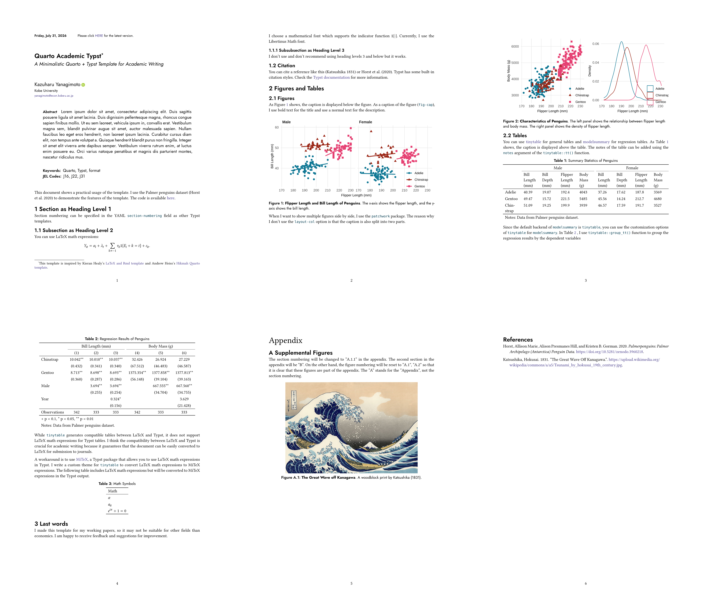

# Quarto-Academic-Typst Format

A Quarto + Typst format for academic documents.
The design is inspired by inspired by Kieran Healy's
[LaTeX and Rmd template](https://github.com/kjhealy/latex-custom-kjh) and
Andrew Heiss's [Hikmah Quarto template](https://github.com/andrewheiss/hikmah-academic-quarto).

Click the image below to see a [demo](https://kazuyanagimoto.com/quarto-academic-typst/template-full.pdf).
Code is available [here](https://github.com/kazuyanagimoto/quarto-academic-typst/blob/main/template-full.qmd).


```{bash}
#| label: thumbnail
#| include: false
quarto render template-full.qmd -M keep-typ:true 
typst compile template-full.typ img/thumbnail.svg --format svg --pages 1
typst compile template-full.typ img/template-full-{p}.png --format png --pages 1-6
magick img/template-full-[1-3].png +append img/template-full-above.png
magick img/template-full-[4-6].png +append img/template-full-below.png
magick img/template-full-above.png img/template-full-below.png -append img/template-full.png
rm img/template-full-*.png
```


[](https://kazuyanagimoto.com/quarto-academic-typst/template-full.pdf)

## Install

If you would like to add the clean theme to an existing directory:

```{.bash}
quarto install extension kazuyanagimoto/quarto-academic-typst
```

or you can use a Quarto template that bundles a .qmd starter file:

```{.bash}
quarto use template kazuyanagimoto/quarto-academic-typst
```

## Python Templates

Pure-Python templates (no R dependency, using the `jupyter: python3` engine) are also available:

- [`template-python.qmd`](template-python.qmd): Minimal example with `matplotlib` plots, booktabs Typst tables, and an appendix (self-contained offline `mtcars` data).
- [`template-full-python.qmd`](template-full-python.qmd): Full example using the Palmer penguins dataset with faceted `matplotlib` plots, KDE density panels, grouped summary tables, `statsmodels` OLS regression tables, and LaTeX-to-MiTeX math rendering inside Typst tables.

Install the Python dependencies listed in [`requirements.txt`](requirements.txt) and render either template with Quarto:

```{.bash}
pip install -r requirements.txt
quarto render template-python.qmd
quarto render template-full-python.qmd
```

